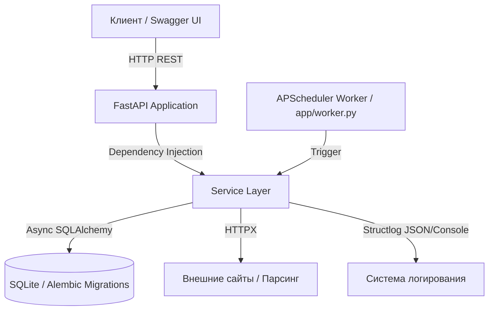

# 🚀 SmartMonitor

[](https://github.com/Jennyyy392/smartmonitor/actions/workflows/ci.yml?query=branch%3Amain)


**SmartMonitor** — это асинхронный микросервис для мониторинга цен на товары. Сервис отслеживает изменения цен по заданным URL, сравнивает их с целевой ценой и отправляет уведомления при достижении цели.

Проект разработан с соблюдением лучших практик enterprise-разработки: чистая архитектура (Service Layer), асинхронная работа с БД, структурированное логирование, миграции и автоматизированный CI/CD.

## 🏗 Архитектура проекта



Поток обработки запроса:

1. **HTTP-слой** (`app/api`) принимает запрос, валидирует данные через Pydantic-схемы и делегирует работу сервису.
2. **Сервисный слой** (`app/services`) содержит бизнес-логику и обращается к БД и внешним сайтам.
3. **Слой данных** (`app/db`) описывает ORM-модели, а миграции управляются через Alembic.
4. **Фоновый воркер** (`APScheduler`) периодически запускает проверку цен, не блокируя обработку HTTP-запросов. Запуск управляется флагом `ENABLE_SCHEDULER`: в локальной разработке планировщик живёт в процессе API (`lifespan`), в Docker — в отдельном процессе `app/worker.py` (сервис `worker`).

## 🛠 Технологический стек и обоснование выбора

- **FastAPI**: Высокая производительность, нативная поддержка async/await и автоматическая генерация Swagger-документации.
- **SQLAlchemy 2.0 (Async) + aiosqlite**: Современный асинхронный ORM для неблокирующей работы с базой данных.
- **Alembic**: Версионирование и управление миграциями схемы базы данных (безопасные upgrade/downgrade).
- **Pydantic v2**: Строгая валидация входящих и исходящих данных.
- **APScheduler**: Надежный планировщик фоновых задач для периодической проверки цен.
- **Structlog**: Структурированное логирование (цветной вывод в dev, JSON в prod) для удобной интеграции с системами мониторинга (ELK, Grafana Loki).
- **Pytest + HTTPX**: Изолированное модульное и интеграционное тестирование API с использованием in-memory SQLite.
- **Ruff**: Молниеносный линтер и форматтер кода для поддержания чистоты и единого стиля.

## 🚀 Быстрый старт

### Вариант 1: Docker (Рекомендуется)

Самый быстрый способ развернуть приложение со всеми зависимостями:

```bash
# 1. Клонировать репозиторий
git clone https://github.com/Jennyyy392/smartmonitor.git
cd smartmonitor

# 2. Создать файл окружения (при необходимости)
echo "DEBUG=False" > .env

# 3. Собрать и запустить контейнеры (api + worker)
docker-compose -f docker/docker-compose.yml up -d --build
```

Приложение будет доступно по адресу: <http://localhost:8000/docs>

Поднимаются два сервиса:

- `api` — HTTP-сервер (`uvicorn app.main:app`), запускается с `ENABLE_SCHEDULER=false`;
- `worker` — отдельный процесс планировщика (`python -m app.worker`) с `ENABLE_SCHEDULER=true`, стартует после успешного health-check сервиса `api`.

Миграции `alembic upgrade head` применяются автоматически при старте контейнера: `docker/entrypoint.sh` подготавливает каталог `/app/data` (проверяет владельца и сбрасывает привилегии root → `appuser` через `gosu`), после чего выполняется `CMD` образа — `alembic upgrade head && uvicorn app.main:app ...`. Оба сервиса используют один смонтированный каталог `./data` с файлом SQLite.

### Вариант 2: Локальный запуск

```powershell
# 1. Создать и активировать виртуальное окружение
python -m venv .venv
.\.venv\Scripts\Activate.ps1

# 2. Установить зависимости
pip install -r requirements.txt

# 3. Применить миграции к базе данных
alembic upgrade head

# 4. Запустить сервер разработки
uvicorn app.main:app --reload
```

## 🗄 Миграции базы данных (Alembic)

Схема БД управляется исключительно через миграции — ручное изменение таблиц не требуется (и не рекомендуется).

```bash
# Применить все миграции до последней ревизии
alembic upgrade head

# Откатить последнюю миграцию
alembic downgrade -1

# Создать новую миграцию по изменениям ORM-моделей
alembic revision --autogenerate -m "add new field"

# Посмотреть текущую ревизию
alembic current
```

## 📖 API Reference

После запуска интерактивная документация доступна по адресам:

- <http://127.0.0.1:8000/docs> — Swagger UI
- <http://127.0.0.1:8000/redoc> — ReDoc

| Метод    | Эндпоинт                             | Описание                                   |
| -------- | ------------------------------------ | ------------------------------------------ |
| `GET`    | `/`                                  | Корневой маршрут, статус сервиса           |
| `GET`    | `/api/v1/health`                     | Проверка работоспособности (health-check)  |
| `POST`   | `/api/v1/products/`                  | Создать товар для отслеживания             |
| `GET`    | `/api/v1/products/`                  | Получить список товаров (с пагинацией)     |
| `GET`    | `/api/v1/products/{id}`              | Получить товар по ID                       |
| `PATCH`  | `/api/v1/products/{id}`              | Частично обновить товар (основной)         |
| `PUT`    | `/api/v1/products/{id}`              | Частично обновить товар (устаревший alias) |
| `DELETE` | `/api/v1/products/{id}`              | Удалить товар                              |
| `POST`   | `/api/v1/products/{id}/check-price`  | Запустить проверку цены вручную            |

### Пагинация `GET /api/v1/products/`

| Параметр | Тип  | По умолчанию | Ограничения | Описание                          |
| -------- | ---- | ------------ | ----------- | --------------------------------- |
| `limit`  | int  | `50`         | `1..100`    | Максимальное число товаров в ответе |
| `offset` | int  | `0`          | `>= 0`      | Смещение от начала выборки        |

```bash
curl "http://127.0.0.1:8000/api/v1/products/?limit=20&offset=40"
```

### Пример запроса

```bash
curl -X POST http://127.0.0.1:8000/api/v1/products/ \
  -H "Content-Type: application/json" \
  -d '{
    "name": "Наушники Sony WH-1000XM5",
    "url": "https://www.ozon.ru/product/...",
    "target_price": 25000.0
  }'
```

## ⚙️ Конфигурация

Настройки читаются из переменных окружения и файла `.env` (см. `app/config.py`):

| Переменная        | Значение по умолчанию                          | Описание                              |
| ----------------- | ---------------------------------------------- | ------------------------------------- |
| `APP_NAME`        | `SmartMonitor`                                 | Название сервиса                      |
| `DEBUG`           | `True`                                         | Режим отладки (влияет на логи и echo) |
| `API_V1_PREFIX`   | `/api/v1`                                      | Префикс маршрутов v1                  |
| `DATABASE_URL`    | `sqlite+aiosqlite:///./data/smartmonitor.db`   | DSN подключения к базе данных         |
| `ENABLE_SCHEDULER`| `True`                                         | Запускать планировщик в процессе (в Docker: `false` для `api`, `true` для `worker`) |

## 🧩 Ключевые инженерные решения

### Асинхронность из коробки

Все слои приложения асинхронны: FastAPI-эндпоинты, сервисы, SQLAlchemy-сессии (`AsyncSession`) и HTTP-запросы через общий `httpx.AsyncClient` из `app/core/http.py`. Это позволяет обслуживать множество запросов без блокировки event loop, а фоновый воркер не мешает обработке HTTP-трафика: локально он работает в процессе API, в Docker — в отдельном контейнере `worker`.

### Глобальная обработка ошибок

В `app/core/exceptions.py` зарегистрирован глобальный обработчик необработанных исключений. Он логирует ошибку с полным стек-трейсом и контекстом запроса, а клиенту возвращает безопасный JSON без утечки внутренних деталей реализации.

### Структурированное логирование (structlog)

Логирование настраивается в зависимости от окружения: в режиме `DEBUG=True` — цветной человекочитаемый вывод для разработки, в `DEBUG=False` — строгий JSON с ISO-таймстампами для продакшена и систем сбора логов (ELK, Grafana Loki). Все логи обогащаются контекстом (например, `product_id`, `url`).

### Фоновые задачи (APScheduler)

Планировщик запускается только при `ENABLE_SCHEDULER=True` (значение по умолчанию). В локальной разработке он стартует в `lifespan`-контексте приложения и корректно останавливается при выключении. В Docker `api` запускается с `ENABLE_SCHEDULER=false`, а планировщик вынесен в отдельный сервис `worker` (`python -m app.worker`), который масштабируется независимо от HTTP-слоя и не дублирует фоновые задачи при нескольких репликах API. Задача `check_all_prices` выполняется каждые `CHECK_INTERVAL_MINUTES` минут (по умолчанию 5), имеет защиту `max_instances=1`, ограничение параллелизма `MAX_CONCURRENT_CHECKS=5` и изолированную сессию БД с обработкой ошибок по каждому товару.

## 🧪 Тестирование

Тесты используют in-memory SQLite и dependency override для полной изоляции от рабочей базы данных.

```bash
# Запустить все тесты
pytest -v

# Проверить код линтером
ruff check .

# Автоматически исправить замечания линтера
ruff check . --fix

# Форматирование кода
ruff format .
```

## 🔄 CI/CD

Проект использует GitHub Actions (`.github/workflows/ci.yml`). Пайплайн запускается при каждом push и pull request в ветку `main` и выполняет:

1. Установку Python 3.12.
2. Кэширование pip-зависимостей для ускорения сборок.
3. Линтинг кода через Ruff.
4. Запуск тестов через Pytest.

Статус сборки отображается бейджем в начале этого файла.

## 📁 Структура проекта

```
smartmonitor/
├── app/
│   ├── main.py              # точка входа, lifespan, регистрация обработчиков
│   ├── worker.py            # отдельный процесс планировщика (python -m app.worker)
│   ├── config.py            # настройки (pydantic-settings)
│   ├── database.py          # асинхронный движок и сессии SQLAlchemy
│   ├── scheduler.py         # фоновый планировщик проверки цен (APScheduler)
│   ├── api/v1/              # HTTP-слой: роутеры и эндпоинты (products, health)
│   ├── core/
│   │   ├── http.py          # единый переиспользуемый httpx.AsyncClient
│   │   ├── logger.py        # structlog: цветной вывод / JSON
│   │   └── exceptions.py    # глобальная обработка ошибок
│   ├── db/                  # ORM-модели и declarative base
│   ├── schemas/             # Pydantic-схемы (валидация)
│   └── services/            # бизнес-логика (product_service, notification_service)
├── alembic/                 # миграции базы данных
├── docker/
│   ├── Dockerfile           # образ приложения
│   ├── docker-compose.yml   # сервисы api и worker
│   └── entrypoint.sh        # подготовка ./data и сброс привилегий до appuser
├── tests/
│   ├── conftest.py          # фикстуры: in-memory SQLite и AsyncClient
│   └── test_products_api.py # тесты CRUD-эндпоинтов товаров
├── scripts/                 # зарезервировано под вспомогательные скрипты (пока только .gitkeep)
└── .github/workflows/       # CI/CD пайплайн
```

## 📄 Лицензия

Проект распространяется под лицензией **MIT**.
